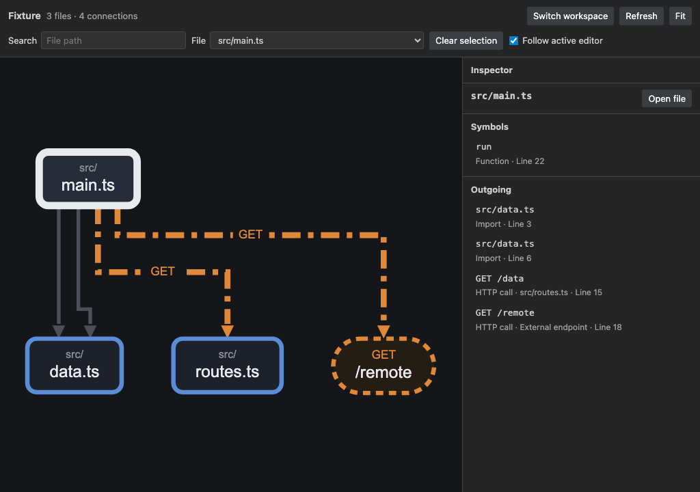

# code-map

Visualize how a JavaScript/TypeScript codebase is actually connected. `code-map` statically analyzes a project, builds its import graph, and serves an interactive boxes-and-arrows diagram in your browser — files as nodes, imports as arrows, circular dependencies flagged in red.


The screenshot uses the included synthetic demo. It needs no API keys or model. Follow [the demo walkthrough](examples/demo/README.md) to inspect executed code, API connections, and a deliberately unused import cycle. [View the real V8 coverage overlay](docs/runtime-demo.png).

## Try the demo

### VS Code extension

Code Map also runs in an editor panel with refresh-on-save, source navigation, and active-file following. File creation, renaming, deletion, and project-configuration changes update the graph. Click a file to open it beside the graph; use the inspector to jump to functions, imports, HTTP calls, and matching route registrations.

From this repository root, after installing the root and web dependencies:

```sh
npm ci --prefix extension
npm run package:extension
```

Install `extension/code-map-0.1.0.vsix` through VS Code's **Extensions → … → Install from VSIX…**, then run **Open Code Map** from the Command Palette in a trusted project folder. VS Code Desktop 1.96 or later is required. [Extension setup and development](extension/README.md) · [Marketplace registration and publishing](extension/PUBLISHING.md).



The screenshot shows the built webview with synthetic test data. Native editor integration is verified separately in the VS Code Extension Development Host. This version rebuilds the saved graph in a background worker; unsaved-buffer analysis, incremental AST caching, runtime tracing, and AI controls remain outside the extension. The CLI and browser app retain their existing features.

### Standalone browser demo

Use Node.js 22 and npm. From a clone of this repository:

```sh
npm ci
npm ci --prefix web
npm test
npm run build
npm run demo
```

The browser opens automatically. For a headless terminal or a different port, use `npm run demo -- --no-open --port 4285`. `Ctrl+C` stops the server.

## Features

- **File-level dependency graph** — every `.ts`/`.tsx`/`.js`/`.jsx`/`.mjs`/`.cjs` file becomes a node; static `import`, `export ... from`, and `require()` relationships become directed edges. Relative, extensionless, and `index` imports are resolved. The nearest `tsconfig.json` or `jsconfig.json` supplies `baseUrl`, `paths`, and inherited resolution options; `.js` specifiers can resolve to TypeScript sources. `node_modules`, build output, and root `.gitignore` matches stay outside the file graph.
- **API call edges** — outbound `fetch` and `axios` requests are detected and drawn as orange dash-dot arrows labeled with their HTTP method. When a matching Express-style route (`app.get("/api/users", …)`) exists in the codebase, the call connects to the file that serves it; otherwise it points to a dashed "endpoint" pill marking an external service. This surfaces client↔server connections that no `import` statement would reveal.
- **AI explanations** — click any edge or file and hit *Explain this connection* to get a plain-English description of what the relationship is and why it exists, generated by a local [Ollama](https://ollama.com) model. Nothing leaves your machine and there is no API cost.
- **AI topic grouping** — hit *Group into topics* and the model reads the whole file list at once, then answers what the codebase is actually made of: 4-5 named topics like "Static analysis" or "Web UI", each with a one-line summary. Every topic becomes a hub node wired to its files, and node colors switch from folder to topic, so the architecture shows up as structure on the canvas rather than a folder tree. Files the model skips are placed by import adjacency instead of left blank.
- **Layered flowchart layout** — files are placed in rows by dependency depth (entry points at the top, leaf utilities at the bottom) and arrows are routed as right angles, so the diagram reads like a hand-drawn architecture chart and looks the same on every reload. Toggle between top-down and left-right, and between uniform and fitted box widths.
- **Interactive exploration** — pan, zoom, search by filename, filter by folder or extension; click a file to see its size, exports, and import counts, with direct neighbors highlighted and everything else dimmed.
- **Symbol drill-down** — expand any file to list its functions, classes, and methods, and which local or imported symbols each one calls.
- **Cycle detection** — circular import chains are found with Tarjan's SCC algorithm and drawn in red, with a "cycles only" toggle to isolate them.
- **Type-only awareness** — TypeScript `import type` edges render dashed so architectural coupling and type coupling read differently.
- **Runs locally or hosted** — the same analyzer powers a one-command CLI and a web service where visitors paste a GitHub URL or drop a zip. Even hosted, explanations run on the visitor's own Ollama, so code is never sent to a third-party model.

## Quick start

```bash
git clone git@github.com:deionchaudhary1/code-map.git
cd code-map
npm ci
npm ci --prefix web
npm run build            # compiles the CLI and the web UI — needed once, and again after any code change
```

Then point it at a project:

```bash
# analyze code-map itself
npx tsx src/cli.ts .

# or any other JS/TS project
npx tsx src/cli.ts /path/to/your/project
```

The CLI analyzes the target, starts a local server on `http://localhost:4280`, and opens the graph in your browser. Analysis happens once at startup, so the graph is ready the moment the page loads.

### Stopping the server

The CLI runs in the foreground and holds the port until you stop it:

```
Ctrl+C          # in the terminal running code-map
```

If you started it in the background (`&`, or a closed terminal), the port stays occupied and the next run fails with `EADDRINUSE`. Find and stop whatever is holding it:

```bash
lsof -ti:4280                  # prints the PID(s) using the port, nothing if free
lsof -ti:4280 | xargs kill     # stop it
```

Or just use a different port and leave the old one alone:

```bash
npx tsx src/cli.ts . --port 4285
```

Nothing persists between runs — no database, no daemon, no cache on disk. Stopping the process releases everything (in hosted mode, that also deletes the session temp directories).

### CLI options

| Flag | Default | Description |
|---|---|---|
| `[dir]` | `.` | Project directory to analyze |
| `-p, --port <port>` | `4280` | Port for the local server |
| `-o, --out <file>` | — | Also write the graph JSON to a file |
| `--no-open` | — | Don't open the browser automatically |
| `--ollama-model <name>` | `llama3.1:8b` | Model used for AI explanations and topic grouping |
| `--no-ai` | — | Disable AI explanations and topic grouping entirely |
| `--run <command>` | — | Run this command and overlay which code actually executed |
| `--trace-timeout <sec>` | `300` | Kill the traced command after this long |

## Runtime tracing

Static analysis shows what *could* run. `--run` shows what *did*: code-map executes a command, collects V8 coverage, and overlays it on the graph so dead code is visibly dead and hot paths are visibly hot.

```bash
npx tsx src/cli.ts . --run "npm test"
npx tsx src/cli.ts . --run "node src/index.js"
```

Output looks like:

```
7 of 41 files executed, 34 never ran (2.0s)
Within those files, 19 of 23 functions were called
```

Turn on **Runtime** in the top bar to dim files that never executed, outline live ones in green with weight scaled by hit count, and add a **Hide unexecuted** filter. The side panel gains per-file execution counts and marks each function `ran 108×` or `never ran`.

The traced command runs in a shell from the project root, exactly as if you had typed it. Its output streams through, and a non-zero exit is reported as a warning rather than a failure — a crashing run is still worth looking at.

**Tracing is local-CLI only.** Hosted mode has no `--run`, no equivalent route, and never executes uploaded code.

### What it can and can't see

- **Node only.** Browser-only code shows as unexecuted unless it also runs under Node (SSR, tests).
- **Analyze what you actually run.** If the command executes `dist/` but you analyzed `src/`, nothing maps — code-map detects this case and tells you so. Either analyze the built directory or run the sources directly (`tsx`).
- **Coverage is flushed on normal process exit**, including a nonzero exit code. A force-killed process may produce no coverage, so long-running servers need a command that terminates on its own. On macOS/Linux, timeouts and CLI interruptions stop the command's process group, including its workers; interruption exits the CLI before it starts a server. On Windows only the immediate shell termination path is implemented and descendant cleanup is unverified.
- **Counts are per function, matched by name**, which survives transpilation; byte offsets do not.
- **Dead files have no function breakdown.** A file that never loaded produces no coverage entry, so the function tally covers only files that executed. Dead *files* are always reported in full.
- Value and argument capture (`--trace-values`) is not implemented.

## Verification and analysis boundaries

`npm test` exercises dependency resolution, ignored files, cycles, inline type-only imports, symbol calls, multi-process coverage merging, actual child-process execution, and timeout cleanup. `npm run typecheck` checks the backend; `npm run build` checks and bundles both sides.

The analyzer does not execute TypeScript configs or bundler plugins. Computed imports, dynamic `import()`, bundler-only aliases, and framework-specific route mounting are not resolved. Literal Express-style routes and HTTP client names are heuristics, so API edges are possible connections rather than proof that a request ran. Runtime symbols match by name; repeated names in transformed sources can remain ambiguous. The Vite production build currently reports a large graph-layout bundle warning.

## Architecture at a glance

| Layer | Responsibility |
| --- | --- |
| Source walker and ts-morph | Select source files and inspect syntax without running project code |
| Shared TypeScript resolver | Interpret nearest project configuration for file and symbol graphs |
| Graph algorithms | Mark strongly connected components and connect literal HTTP calls to route registrations |
| V8 coverage collector | Run an explicitly supplied local command, merge process reports, and map execution to the graph |
| Express and React/ELK | Serve graph APIs and render a layered, interactive architecture diagram |
| Optional Ollama integration | Explain selected relationships and suggest topic groups locally |

## Hosted mode

The same tool can run as a web service where people paste a public GitHub URL or drop a `.zip` and get their map in the browser, with nothing to install:

```bash
npm run build
npm run serve                 # http://localhost:4280
PORT=4290 npm run serve       # or on another port
```

Stop it the same way as the local server — `Ctrl+C`, or `lsof -ti:4290 | xargs kill` if it's in the background. Note that hosted mode and the local CLI both default to port `4280`, so they cannot run at once without giving one of them `--port` / `PORT`.

Each upload or clone becomes a session backed by a temp directory that is deleted when the session expires (30 minutes idle by default). Uploaded code is parsed statically and **never executed**.

AI explanations still cost nothing and still stay private: the server assembles the prompt (it has the files) but the *browser* sends it to your own Ollama, so your code never reaches a third-party model. Because the page and Ollama are different origins, Ollama has to be told to trust the site:

```bash
OLLAMA_ORIGINS=https://your-code-map-domain ollama serve
```

A page served from `localhost` needs no such setup — Ollama allows localhost by default. The in-app **AI settings** panel shows the exact command for whatever origin you're on and can test the connection.

### Hosted configuration

All optional, via environment variables:

| Variable | Default | Description |
|---|---|---|
| `PORT` | `4280` | Port to listen on |
| `OLLAMA_MODEL` | `llama3.1:8b` | Model suggested to the browser |
| `SESSION_TTL_MS` | `1800000` | Idle time before a session and its files are deleted |
| `MAX_UPLOAD_BYTES` | `52428800` | Largest accepted `.zip` (50 MB) |
| `MAX_REPO_BYTES` | `209715200` | Largest accepted repo/expansion (200 MB) |
| `MAX_FILES` | `5000` | Source-file cap per project |
| `CLONE_TIMEOUT_MS` | `60000` | Clone timeout |
| `RATE_LIMIT_MAX` | `10` | Analyses per IP per 15 minutes |
| `ALLOWED_GIT_HOSTS` | `github.com` | Comma-separated clone allowlist |

Hosted mode requires `git` on `PATH`. Clone URLs must be `https://`, on the allowlist, credential-free, and must not resolve to a private address; zip entries that escape the archive root, are absolute, or are symlinks are rejected, and expansion aborts mid-archive once the size or file cap is hit.

### AI explanations (optional)

Explanations are generated locally by Ollama — the rest of the tool works without it.

```bash
# one-time setup
brew install ollama      # or see ollama.com
ollama serve             # start the daemon
ollama pull llama3.1:8b  # ~4.9 GB
```

code-map checks availability at startup and prints whether explanations are enabled. If Ollama isn't running or the model isn't pulled, the graph still works fully and the explain button reports exactly what's missing. Set `OLLAMA_HOST` to point at a non-default daemon address.

## How it works

```
code-map <dir>
   │
   ├─ walks the file tree (respects .gitignore)
   ├─ parses every file with ts-morph (TypeScript compiler API)
   ├─ resolves imports → file-level graph + Tarjan SCC cycle detection
   ├─ detects fetch/axios calls + Express routes → API call edges
   │
   └─ serves a local web app
        GET  /api/config                 → which mode the frontend is talking to
        GET  /api/graph                  → full FileGraph JSON
        GET  /api/symbols?file=<path>    → per-file function/call graph (on demand)
        POST /api/explain                → LLM explanation of an edge or file (on demand)
```

Hosted mode runs the same analyzer behind session-scoped routes — `POST /api/upload` and `POST /api/clone` create a session, and `/api/sessions/<id>/{graph,symbols,explain-context}` mirror the local routes under a prefix. `explain-context` returns the assembled prompt rather than an explanation, because the model runs in the visitor's browser. The frontend asks `/api/config` at startup instead of being compiled for one mode, so a single `web/dist` build serves both.

In local mode everything runs in one process — no hosting, no database, and the only network call is to Ollama on `localhost`. Hosted mode adds a session registry and temp directories but still needs no database. The frontend is Vite + React rendering the graph on canvas via `react-force-graph-2d`, with node positions and right-angle edge routes computed by ELK (`elkjs`) in a web worker.

Explanations are generated per click rather than up front (most edges are never inspected), sent as a small context bundle of file paths, symbols, and short code excerpts, and cached in memory so re-opening the same edge is instant.

## Project layout

```
src/
  cli.ts             CLI entry (commander)
  server.ts          Express server: /api/graph, /api/symbols, /api/explain
  types.ts           shared graph schema (FileGraph, SymbolGraph, ...)
  analyzer/
    walk.ts          directory walker with .gitignore support
    fileGraph.ts     import/export extraction → FileGraph
    symbolGraph.ts   per-file function/class call graph
    apiCalls.ts      fetch/axios call detection + route resolution
    routes.ts        Express-style route registration scanner
    scc.ts           Tarjan's strongly-connected-components
  trace/
    runner.ts        spawns the traced command, folds coverage into a RuntimeTrace
    coverage.ts      merges V8 coverage across processes, maps it onto the graph
  llm/
    ollama.ts        local Ollama client + availability check
    explain.ts       prompt assembly and explanation cache
    explainTarget.ts request-body parsing shared by both servers
    topics.ts        topic-clustering prompt, reply parser, import-graph backfill
  hostedServer.ts    hosted multi-session server (upload / clone)
  hostedCli.ts       hosted entry point (env-var configuration)
  ingest/
    zip.ts           guarded zip extraction (traversal, bombs, symlinks)
    gitClone.ts      URL validation + guarded shallow clone
  session/
    store.ts         session registry, TTL sweep, temp-dir cleanup
    scrub.ts         strips server paths from graphs sent to clients
web/                 Vite + React frontend (graph UI)
plans/               project plans
```

## Limitations

- **JS/TS only** for now; other languages are on the roadmap.
- **Static analysis by default** — dynamic `import()`, computed calls, and calls through reassigned references don't produce edges. `--run` recovers what actually executed (see Runtime tracing). API calls whose URL is built from variables are shown as `<dynamic>` and can't be matched to a route.
- **Route matching targets Express-style registration** (`app.get`/`router.post` on a receiver named `app`, `router`, `server`, or `api`). Fastify, Koa, and Next.js route files aren't matched yet, so their calls render against external endpoints.
- **Explanation quality tracks the local model.** `llama3.1:8b` is good at describing a connection it's been handed, but it only sees the two files involved plus short excerpts — it can't reason about the whole architecture, and it will occasionally speculate. Treat explanations as orientation, not documentation.
- **Large repos** (thousands of files) render but haven't been tuned; expect a busy layout until clustering lands.
- **Hosted mode holds sessions in memory and analysis is synchronous.** Sessions don't survive a restart and won't work behind a load balancer without sticky routing, and one large analysis briefly blocks others in the same process — the file and size caps are what keep that bounded. Private repositories aren't supported.

## Roadmap

- Runtime value capture (`--trace-values`): argument/return shapes and sample values, per `plans/RUNTIME.md`
- Run hosted analysis in a worker thread so one large project can't block others
- Export the current view as PNG/SVG and shareable graph snapshots
- Folder clustering / "top N most-connected files" default view for large repos
- Cross-file symbol-level graph ("who calls this exported function anywhere")
- Route detection for Fastify, Koa, and Next.js API routes; GraphQL operations
- Whole-codebase Q&A using embeddings (`nomic-embed-text`) rather than per-edge context
- Python support via a second parser targeting the same graph schema
- VS Code extension reusing the same analyzer core

## License

MIT
