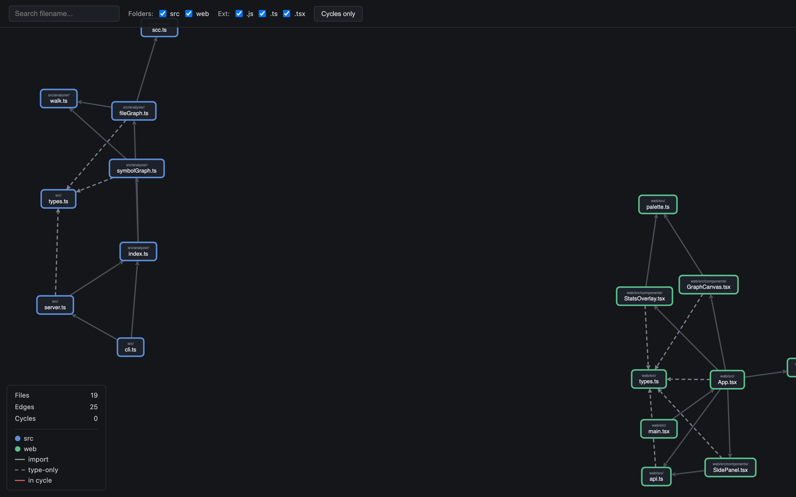

# code-map

Visualize how a JavaScript/TypeScript codebase is actually connected. `code-map` statically analyzes a project, builds its import graph, and serves an interactive boxes-and-arrows diagram in your browser — files as nodes, imports as arrows, circular dependencies flagged in red.



## Features

- **File-level dependency graph** — every `.ts`/`.tsx`/`.js`/`.jsx`/`.mjs`/`.cjs` file becomes a node; static `import`, `export ... from`, and `require()` relationships become directed edges. Relative, extensionless, and `index` imports are resolved; `node_modules`, build output, and anything in `.gitignore` are skipped.
- **Interactive exploration** — pan, zoom, and drag; search by filename; filter by folder or extension; click a file to see its size, exports, and import counts, with direct neighbors highlighted and everything else dimmed.
- **Symbol drill-down** — expand any file to list its functions, classes, and methods, and which local or imported symbols each one calls.
- **Cycle detection** — circular import chains are found with Tarjan's SCC algorithm and drawn in red, with a "cycles only" toggle to isolate them.
- **Type-only awareness** — TypeScript `import type` edges render dashed so architectural coupling and type coupling read differently.

## Quick start

```bash
git clone git@github.com:deionchaudhary1/code-map.git
cd code-map
npm install
npm install --prefix web
npm run build

# analyze any local JS/TS project
npx tsx src/cli.ts /path/to/your/project
```

The CLI analyzes the target, starts a local server (default `http://localhost:4280`), and opens the graph in your browser.

### CLI options

| Flag | Default | Description |
|---|---|---|
| `[dir]` | `.` | Project directory to analyze |
| `-p, --port <port>` | `4280` | Port for the local server |
| `-o, --out <file>` | — | Also write the graph JSON to a file |
| `--no-open` | — | Don't open the browser automatically |

## How it works

```
code-map <dir>
   │
   ├─ walks the file tree (respects .gitignore)
   ├─ parses every file with ts-morph (TypeScript compiler API)
   ├─ resolves imports → file-level graph + Tarjan SCC cycle detection
   │
   └─ serves a local web app
        GET /api/graph                  → full FileGraph JSON
        GET /api/symbols?file=<path>    → per-file function/call graph (computed on demand)
```

Everything runs locally in one process — no hosting, no database, no network calls. The frontend is Vite + React rendering the graph on canvas via `react-force-graph-2d`.

## Project layout

```
src/
  cli.ts             CLI entry (commander)
  server.ts          Express server: /api/graph, /api/symbols, static frontend
  types.ts           shared graph schema (FileGraph, SymbolGraph, ...)
  analyzer/
    walk.ts          directory walker with .gitignore support
    fileGraph.ts     import/export extraction → FileGraph
    symbolGraph.ts   per-file function/class call graph
    scc.ts           Tarjan's strongly-connected-components
web/                 Vite + React frontend (graph UI)
plans/               project plans
```

## Limitations

- **JS/TS only** for now; other languages are on the roadmap.
- **Static analysis only** — dynamic `import()`, computed calls, and calls through reassigned references don't produce edges.
- **Large repos** (thousands of files) render but haven't been tuned; expect a busy layout until clustering lands.

## Roadmap

- Export the current view as PNG/SVG and shareable graph snapshots
- Folder clustering / "top N most-connected files" default view for large repos
- Cross-file symbol-level graph ("who calls this exported function anywhere")
- Python support via a second parser targeting the same graph schema
- VS Code extension reusing the same analyzer core

## License

MIT
