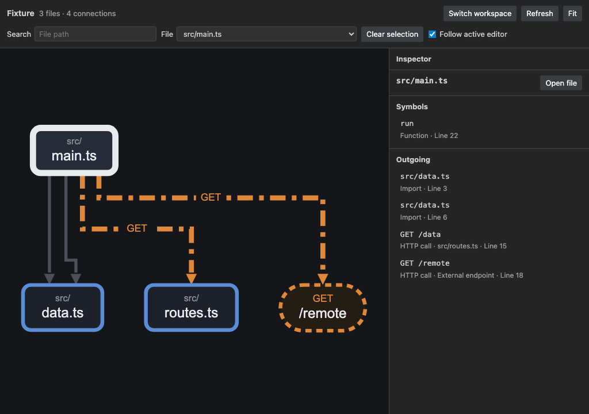

# Code Map for VS Code

Explore imports, circular dependencies, and detectable HTTP routes and calls across a JavaScript or TypeScript project. Open the source for a file or connection directly from the interactive graph.

## Use Code Map

Open a trusted folder in VS Code Desktop 1.96 or later. Run **Open Code Map** from the Command Palette to analyze it. In a multi-root workspace, use **Code Map: Choose Workspace** to switch folders.

Search by file path, select a file to inspect its symbols, or select a connection to open its source location. Enable **Follow active editor** to select the current file whenever you switch editors. Use **Code Map: Refresh** to reread the selected workspace folder.

Code Map analyzes saved files on the workspace host. It runs without an external service or account.

Unsaved edits display a notice and enter the map after saving. Analysis runs in a separate Node worker and graph layout runs in a webview worker. Refreshes retain the last successful graph, selection, and zoom; use **Fit** to reframe it. This first version rebuilds the saved graph rather than maintaining an incremental AST index. Runtime coverage and AI explanations remain available through the standalone code-map app.



The screenshot shows the built webview with synthetic data. The native save/navigation flow is also tested in a VS Code Extension Development Host.

| Setting | Default | Effect |
| --- | --- | --- |
| `codeMap.autoRefresh` | `true` | Update the graph when supported sources or project configuration change. |
| `codeMap.maxFiles` | `5000` | Set the source-file limit for a workspace folder, from 1 to 20,000. |

## Build and install locally

Use Node.js 22 or later for the build tools. From the repository root, run the following commands.

```sh
npm ci
npm --prefix web ci
npm --prefix extension ci
npm --prefix extension run package
```

In the VS Code Extensions view, open **Views and More Actions** and choose **Install from VSIX…**. Select `extension/code-map-0.1.0.vsix`. If the `code` shell command is available, you can install from the repository root.

```sh
code --install-extension extension/code-map-0.1.0.vsix
```

`code-map-local` is the placeholder publisher ID for local builds. See the [Marketplace publishing guide](https://github.com/deionchaudhary1/code-map/blob/main/extension/PUBLISHING.md) to register your own publisher and prepare a public release.

## Develop and test

From the repository root, run `npm --prefix extension run build` after installing the dependencies above. Open the repository in VS Code and press **F5** using the **Run Code Map Extension** launch configuration. In the Extension Development Host, open a trusted folder such as `examples/demo` and run **Open Code Map**. Rebuild after source changes and restart the development host to pick them up.

```sh
npm --prefix extension run typecheck
npm --prefix extension test
npm --prefix extension run test:integration
```

The integration runner downloads VS Code 1.96.4 on first use and launches it with a temporary profile and a copy of the demo workspace. Set `CODE_MAP_VSCODE_EXECUTABLE` to use an existing VS Code executable, or `CODE_MAP_VSCODE_VERSION` to test a different version.

For the optional browser checks, set `CHROMIUM_PATH` to a Chrome/Chromium executable and run `npm --prefix extension run test:webview` from the repository root. The checks use synthetic graph data, a temporary browser profile, and the webview content security policy. They exercise the actual bundled layout worker and canvas interactions without a local HTTP server. No browser download is performed by that command.
